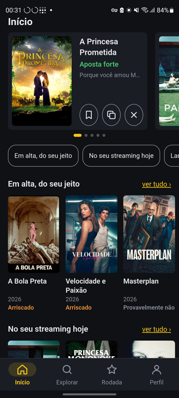
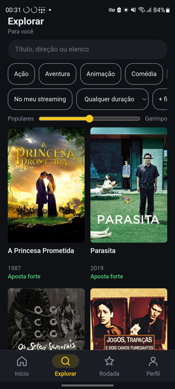
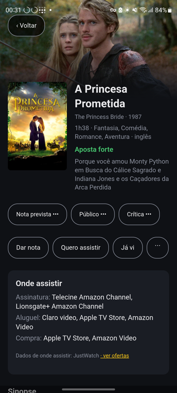

<div align="center">

# 🎬 Cinelens

**Pare de rolar catálogo. Descubra o que você vai gostar de assistir hoje.**

Recomendações de filmes, séries e animes feitas para o seu gosto, que rodam no seu Android, sem servidor e sem anúncios.

[**Baixar o APK**](https://github.com/LucasJLBraz/cinelens/releases/latest) · [Instalar pelo Obtainium](#instalar) · [Como funciona](#como-funciona)

<table>
  <tr>
    <td align="center"></td>
    <td align="center"></td>
    <td align="center"></td>
  </tr>
  <tr>
    <td align="center"><b>Início</b><br>O que ver hoje, já escolhido</td>
    <td align="center"><b>Explorar</b><br>Do popular ao garimpo</td>
    <td align="center"><b>Filme</b><br>Por que ver e onde ver</td>
  </tr>
</table>

</div>

## Por que o Cinelens

- **Aprende o seu gosto.** Cada obra ganha uma nota prevista só para você, que muda a cada nota que você dá. Nas 38 notas mais recentes do dono do projeto em filmes que o modelo conhece, o erro médio foi de 0,43 estrela ([medições](docs/guides/v2-release-check.md#2-precisão-em-filmes)).
- **Explica cada sugestão.** "Porque você amou Monty Python em Busca do Cálice Sagrado": você sabe de onde ela veio.
- **Seus dados ficam com você.** As notas ficam no aparelho e, se quiser, no seu próprio Google Drive. Não há servidor nem anúncios, e nenhuma conta é obrigatória.
- **Não faz esperar.** O Início aparece em menos de 1 s num Galaxy S20 FE, e tudo roda no aparelho.

## O que dá para fazer

**Escolher o que ver**

- **Início:** destaques do dia e listas prontas com filmes, séries e animes. Puxe a tela para ver outras sugestões.
- **Explorar:** cerca de 91 mil filmes, 5,7 mil séries e 2,9 mil animes, com filtros e uma busca que perdoa erro de digitação.
- **Populares ↔ Garimpo:** um controle que vai do que todo mundo viu às joias escondidas.
- **Parecidos, mas…:** parta de um filme de que gostou e peça algo mais leve, mais curto ou mais recente.
- **Onde assistir:** assinatura, aluguel ou compra no Brasil, e um filtro para os seus streamings.

**Ensinar seu gosto**

- **Rodada rápida:** dê notas em sequência e ensine o app em minutos.
- **Notas do seu jeito:** uma Reação de um toque ou estrelas. Em animes, vale a obra inteira ou uma temporada.
- **Sem spoiler de nota:** a previsão fica escondida até você dar a sua, para não influenciar.
- **Marcas:** Quero assistir, Assistindo, Já vi e Não me interessa.

**Acompanhar**

- **Próxima temporada:** uma fileira com a continuação dos animes de que você gostou ou está assistindo.
- **Aviso semanal:** no máximo um por semana, quando sai algo com cara de Aposta forte para você.
- **Estatísticas:** o que suas notas dizem sobre você.
- **Compartilhar:** envie uma obra como card, com onde assistir.
- **Sync e importação:** traga seu histórico do MovieLens e sincronize aparelhos pelo Google Drive.

## Instalar

1. Instale o [Obtainium](https://github.com/ImranR98/Obtainium).
2. Toque em **Adicionar app** e cole `https://github.com/LucasJLBraz/cinelens`.
3. Pronto: ele avisa e instala cada versão nova.

Prefere sem Obtainium? Baixe o APK em [Releases](https://github.com/LucasJLBraz/cinelens/releases/latest).

Na primeira abertura o app baixa o catálogo, uma vez só. A conta Google é opcional.

## Como funciona

Tudo o que recomenda roda no aparelho ([ADR 0001](docs/adr/0001-local-first-split-model.md)). O GitHub Actions só prepara os dados que o app baixa, publicados como releases:

| Dado | De onde vem | Quando atualiza |
|---|---|---|
| Catálogo | TMDB, e OMDb para a crítica dos filmes | Todo dia |
| Fatores de filmes | Notas do MovieLens `ml-latest` | Todo mês |
| Fatores de animes | Notas do MyAnimeList | Só sob demanda |

A nota prevista depende do tipo de obra, e cada tipo guarda suas evidências:

| Tipo | Previsão vem de | Suas notas nesse tipo mudam |
|---|---|---|
| Filmes | Fatores do MovieLens | Filmes, e também séries e animes |
| Séries | Conteúdo e suas notas em filmes | Só séries |
| Animes | Fatores do MyAnimeList e suas notas em filmes | Só animes |

Os dados de um filme no catálogo têm no máximo 7 dias, incluindo onde assistir.

Para ir além: [glossário](GLOSSARY.md), [decisões](docs/adr/), [medição de precisão](docs/guides/accuracy.md) e [design completo](docs/superpowers/specs/2026-10-24-cinelens-design.md).

## Desenvolver

| Pasta | O quê |
|---|---|
| `core/` | Núcleo em Rust: recomendação, filtros, listas, sync, importação do MovieLens |
| `src-tauri/` | App Tauri 2: downloads, arquivos, sync com o Drive, login Google |
| `ui/` | A interface, uma página HTML |
| `catalog/` | Job que monta o catálogo |
| `train/` | Jobs que treinam os fatores, e `cinelens-accuracy` para medir a nota prevista |

```bash
cargo test -p cinelens-core -p cinelens-train -p cinelens-catalog
```

```bash
npm ci && npm run tauri -- android dev
```

Guias de configuração: [TMDB](docs/guides/tmdb.md), [OMDb](docs/guides/omdb.md), [Google Drive](docs/guides/google.md), [Kaggle](docs/guides/kaggle.md) e [publicar versão](docs/guides/release.md). Checklists de versão: [v1](docs/guides/v1-release-check.md), [v2](docs/guides/v2-release-check.md) e [v3](docs/guides/v3-release-check.md).

## Dados e licenças

- [MovieLens](https://grouplens.org/datasets/movielens/) `ml-latest`, GroupLens: F. Maxwell Harper e Joseph A. Konstan, "The MovieLens Datasets: History and Context", ACM TiiS 5(4), 2015. Uso não comercial.
- Fatores de animes treinados com notas do [MyAnimeList](https://myanimelist.net/), pelo dump de novembro de 2023 de Gatchalian, ligados ao TMDB por [`Fribb/anime-lists`](https://github.com/Fribb/anime-lists). Os dados das notas não ficam no repositório ([ADR 0004](docs/adr/0004-anime-factors-from-myanimelist.md)).
- Metadados e imagens do [TMDB](https://www.themoviedb.org/). Este produto usa a API do TMDB, mas não é endossado nem certificado pelo TMDB.
- Onde assistir: dados do [JustWatch](https://www.justwatch.com/), via TMDB.
- Notas da crítica via [OMDb](https://www.omdbapi.com/).

O modelo publicado herda os termos não comerciais do MovieLens. O projeto é pessoal e não comercial.
